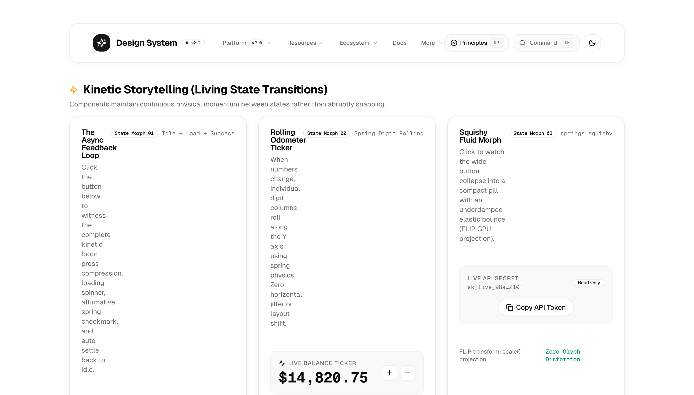
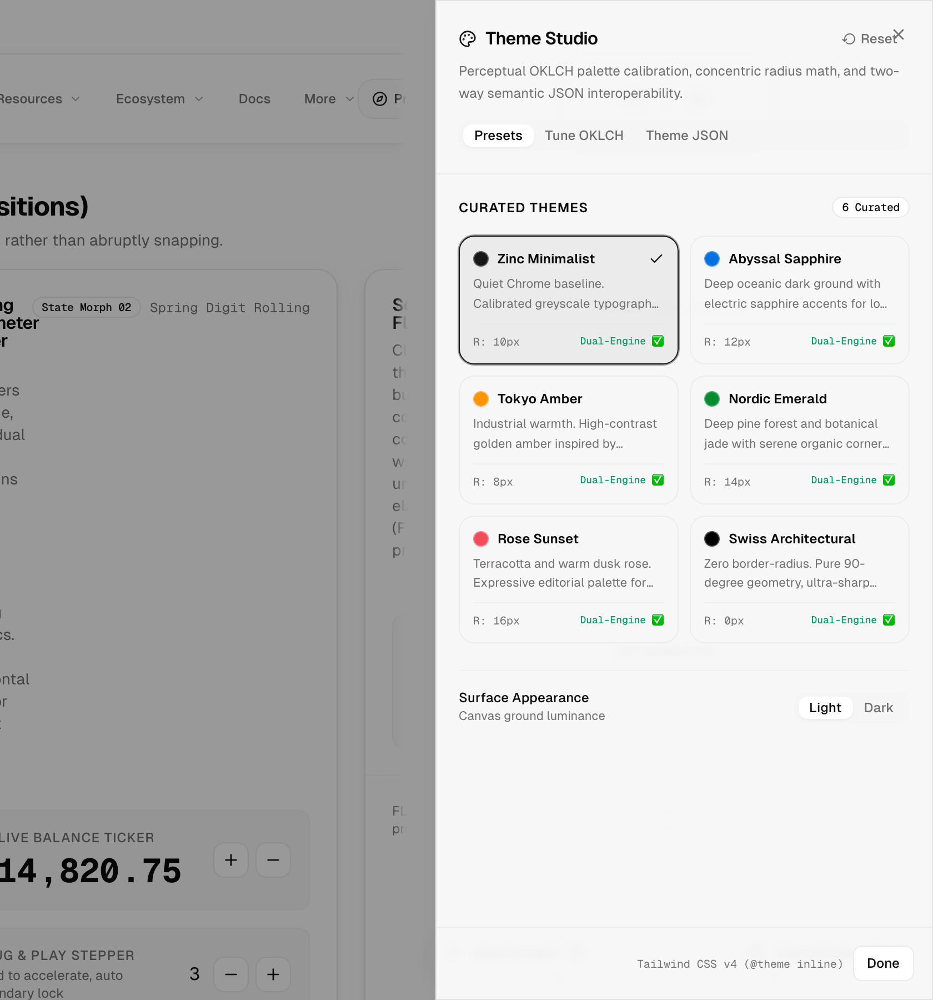
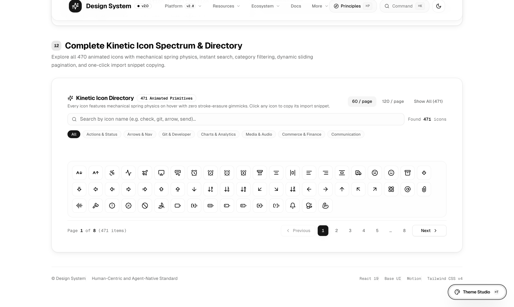

# Design System

> A human-centric, agent-native design system built with **React 19**, **Base UI (`@base-ui/react`)**, **Tailwind CSS v4**, and **Motion (`motion/react`)**.
>
> Crafted at the intersection of visual precision, tactile physics, and zero-shift layout stability. 100% accessible (WCAG 2.2 AA / AAA), copy-paste friendly, with zero heavy npm package lock-in.

<p align="center">
  
</p>

---

## 🚀 60-Second Quick Start (Explore the Interactive Demo)

If you have Node.js installed, you can launch the living interactive workbench right now:

```bash
# 1. Clone this repository
git clone https://github.com/WDibble/design-system.git
cd design-system

# 2. Install dependencies
npm install

# 3. Start the local dev server
npm run dev
```

Open [`http://localhost:5173`](http://localhost:5173) in your browser. You will see all 51 primitives, the real-time Theme Studio (⌘T), 470+ kinetic animated icons, and living interactive state transitions.

To verify TypeScript, invariants, and bundle a production build:

```bash
npm run check
```

---

## 👶 Day 1 with React? Start Here!

Welcome to React! If you have never used a component library before, do not worry. This design system does not require complex configurations or black-box npm packages. You own the code.

### What is a "Component"?

In React, a component is like a custom LEGO brick. Instead of writing raw HTML `<button class="...">` with hundreds of styling classes everywhere, you simply import `<Button>` and use it:

```tsx
import { Button } from "@/components/ui/button";

export default function MyFirstApp() {
  return (
    <div className="flex gap-3 p-8">
      <Button variant="default">Get Started</Button>
      <Button variant="outline">Learn More</Button>
    </div>
  );
}
```

---

## 📋 How to Add These Components to Your Own Project

Whether you are using **Next.js (App Router / Pages)**, **Vite**, **Remix**, or **Astro**, here is the 4-step guide to dropping any component into your project:

### Step 1: Install the Dependencies

In your project folder, open your terminal and install these helper packages:

```bash
npm install @base-ui/react motion clsx tailwind-merge class-variance-authority lucide-react
```

| Package                    | What it does                                                                                    |
| :------------------------- | :---------------------------------------------------------------------------------------------- |
| `@base-ui/react`           | Accessible, headless primitives (menus, popovers, dialogs, sliders) by the creators of Base UI. |
| `motion`                   | Apple HIG fluid spring physics for smooth presses, sliding tabs, and enters.                    |
| `class-variance-authority` | Manages component variants (e.g. `variant="default" \| "outline" \| "destructive"`).            |
| `clsx` & `tailwind-merge`  | Safely combines Tailwind CSS classes without style conflicts.                                   |
| `lucide-react`             | Clean, modern vector icons.                                                                     |

---

### Step 2: Add the Two Helper Files

Every component uses two tiny helper files. Copy them into your project:

#### 1. Class Utility (`src/lib/utils.ts`)

Creates the `cn()` helper used to merge Tailwind classes cleanly:

```ts
import { clsx, type ClassValue } from "clsx";
import { twMerge } from "tailwind-merge";

export function cn(...inputs: ClassValue[]) {
  return twMerge(clsx(inputs));
}
```

#### 2. Motion Physics Constants (`src/tokens/motion.ts`)

Contains the calibrated Apple HIG spring physics settings:

```ts
export const springs = {
  tactile: { type: "spring", stiffness: 600, damping: 30, mass: 0.8 },
  dialog: { type: "spring", stiffness: 350, damping: 35, mass: 1.0 },
  snappy: { type: "spring", stiffness: 550, damping: 35, mass: 0.6 },
  micro: { type: "spring", stiffness: 700, damping: 40 },
  squishy: { type: "spring", stiffness: 420, damping: 24, mass: 0.8 },
} as const;
```

---

### Step 3: Add the Theme Colours to Your CSS (`src/index.css`)

Copy the theme tokens from [`src/index.css`](src/index.css) into your project's main stylesheet.

These use modern perceptual **OKLCH colour spaces** and compile cleanly with standard design token architectures:

<p align="center">
  
</p>

```css
@import "tailwindcss";

@layer base {
  :root {
    --background: oklch(1 0 0);
    --foreground: oklch(0.145 0 0);
    --card: oklch(1 0 0);
    --card-foreground: oklch(0.145 0 0);
    --primary: oklch(0.205 0 0);
    --primary-foreground: oklch(0.985 0 0);
    --secondary: oklch(0.97 0 0);
    --secondary-foreground: oklch(0.205 0 0);
    --muted: oklch(0.97 0 0);
    --muted-foreground: oklch(0.54 0 0);
    --destructive: oklch(0.577 0.245 27.325);
    --destructive-foreground: oklch(0.985 0 0);
    --border: oklch(0.922 0 0);
    --input: oklch(0.922 0 0);
    --ring: oklch(0.5 0 0);
    --radius: 0.625rem;
  }

  .dark {
    --background: oklch(0.145 0 0);
    --foreground: oklch(0.985 0 0);
    --card: oklch(0.17 0 0);
    --card-foreground: oklch(0.985 0 0);
    --primary: oklch(0.985 0 0);
    --primary-foreground: oklch(0.205 0 0);
    --secondary: oklch(0.269 0 0);
    --secondary-foreground: oklch(0.985 0 0);
    --muted: oklch(0.269 0 0);
    --muted-foreground: oklch(0.708 0 0);
    --destructive: oklch(0.396 0.141 25.723);
    --destructive-foreground: oklch(0.985 0 0);
    --border: oklch(0.269 0 0);
    --input: oklch(0.269 0 0);
    --ring: oklch(0.58 0 0);
  }
}
```

> **Using Tailwind CSS v3 instead of v4?**
> If your project uses `tailwind.config.js`, simply map the colours under `theme.extend.colors`:
> `colors: { primary: "var(--primary)", background: "var(--background)", ... }`.

---

### Step 4: Copy Any Component and Use It!

Copy the component file you want from [`src/components/ui/`](src/components/ui/) into your project's `src/components/ui/` folder.

#### Example: Button with Loading and Success Feedback

```tsx
import { Button } from "@/components/ui/button";

export function SubmitButton() {
  return (
    <Button variant="default" onClick={() => alert("Button clicked!")}>
      Click Me
    </Button>
  );
}
```

#### Example: Accessible Text Input with Label and Error

```tsx
import { Field, FieldLabel, FieldDescription, FieldError } from "@/components/ui/field";
import { Input } from "@/components/ui/input";

export function EmailForm() {
  return (
    <Field>
      <FieldLabel requiredIndicator>Work Email</FieldLabel>
      <Input placeholder="you@company.com" type="email" />
      <FieldDescription>We will send your account verification link here.</FieldDescription>
    </Field>
  );
}
```

---

## 🧩 Complete Component Catalogue (All 51 Primitives)

All components are located in [`src/components/ui/`](src/components/ui/) and exported through [`src/components/ui/index.ts`](src/components/ui/index.ts):

### 1. Actions & Controls

| Component              | Path                                                                                 | Description                                                                                                                                         |
| :--------------------- | :----------------------------------------------------------------------------------- | :-------------------------------------------------------------------------------------------------------------------------------------------------- |
| **`Button`**           | [`src/components/ui/button.tsx`](src/components/ui/button.tsx)                       | 9-state interactive matrix, automatic async Promise lifecycle, loading spinner, success checkmark, 44px touch target, physical `pointerdown` yield. |
| **`Toggle`**           | [`src/components/ui/toggle.tsx`](src/components/ui/toggle.tsx)                       | Two-state toggle button with tactile spring feedback and aria-pressed attributes.                                                                   |
| **`ToggleGroup`**      | [`src/components/ui/toggle-group.tsx`](src/components/ui/toggle-group.tsx)           | Grouped single or multi-select toggles with roving tabindex and keyboard navigation.                                                                |
| **`Toolbar`**          | [`src/components/ui/toolbar.tsx`](src/components/ui/toolbar.tsx)                     | Accessible toolbar container grouping interactive actions with orientation support.                                                                 |
| **`MarkdownToolbar`**  | [`src/components/ui/markdown-toolbar/`](src/components/ui/markdown-toolbar/)         | Modular rich-text formatting controls with list toggle logic and heading sanitisation.                                                              |
| **`SegmentedControl`** | [`src/components/ui/segmented-control.tsx`](src/components/ui/segmented-control.tsx) | Sliding pill segmented toggle with layout animation and arrow key navigation.                                                                       |
| **`CopyButton`**       | [`src/components/ui/copy-button.tsx`](src/components/ui/copy-button.tsx)             | Clipboard copy button with spring state morph (`"Copy"` to `"Copied!"`).                                                                            |
| **`ThemeToggle`**      | [`src/components/ui/theme-toggle.tsx`](src/components/ui/theme-toggle.tsx)           | Turnkey dark/light mode toggle with transition flash suppression and localStorage synchronisation.                                                  |
| **`Toast`**            | [`src/components/ui/toast.tsx`](src/components/ui/toast.tsx)                         | Accessible notification toasts with undo action support and countdown dismissal.                                                                    |

### 2. Forms & Inputs

| Component        | Path                                                                     | Description                                                                                         |
| :--------------- | :----------------------------------------------------------------------- | :-------------------------------------------------------------------------------------------------- |
| **`Input`**      | [`src/components/ui/input.tsx`](src/components/ui/input.tsx)             | High-precision text input with left/right icons, prefix/suffix chips, and iOS font-zoom prevention. |
| **`Textarea`**   | [`src/components/ui/textarea.tsx`](src/components/ui/textarea.tsx)       | Multiline text area with subtle 1px border-hugging focus ring.                                      |
| **`Field`**      | [`src/components/ui/field.tsx`](src/components/ui/field.tsx)             | Accessible form control compound component binding labels, descriptions, and error states.          |
| **`Select`**     | [`src/components/ui/select.tsx`](src/components/ui/select.tsx)           | Base UI dropdown select with keyboard navigation, checkmarks, and liquid glass popup.               |
| **`Combobox`**   | [`src/components/ui/combobox.tsx`](src/components/ui/combobox.tsx)       | Searchable auto-complete combobox with keyboard roving navigation and empty states.                 |
| **`Checkbox`**   | [`src/components/ui/checkbox.tsx`](src/components/ui/checkbox.tsx)       | Tri-state checkbox (checked, unchecked, indeterminate) with 44px hit-slop expansion.                |
| **`RadioGroup`** | [`src/components/ui/radio-group.tsx`](src/components/ui/radio-group.tsx) | Accessible radio selection group with arrow key roving focus.                                       |
| **`Switch`**     | [`src/components/ui/switch.tsx`](src/components/ui/switch.tsx)           | Apple HIG toggle switch with tactile spring travel and physical active elongation.                  |
| **`Slider`**     | [`src/components/ui/slider.tsx`](src/components/ui/slider.tsx)           | Direct manipulation slider with 1:1 pointer scrubbing, value bubble, and locked track height.       |
| **`Stepper`**    | [`src/components/ui/stepper.tsx`](src/components/ui/stepper.tsx)         | Number stepper with hold-to-accelerate speed and integrated odometer ticker.                        |
| **`InputOTP`**   | [`src/components/ui/input-otp.tsx`](src/components/ui/input-otp.tsx)     | One-time password PIN boxes with SMS autofill, clipboard paste regex, and blinking caret.           |
| **`FileUpload`** | [`src/components/ui/file-upload.tsx`](src/components/ui/file-upload.tsx) | Drag-and-drop file upload zone with file type validation, size limits, and progress feedback.       |

### 3. Overlays & Dialogs (Base UI)

| Component          | Path                                                                         | Description                                                                                   |
| :----------------- | :--------------------------------------------------------------------------- | :-------------------------------------------------------------------------------------------- |
| **`Dialog`**       | [`src/components/ui/dialog.tsx`](src/components/ui/dialog.tsx)               | Modal dialog with focus trapping, backdrop blur, specular rim lighting, and Escape dismissal. |
| **`AlertDialog`**  | [`src/components/ui/alert-dialog.tsx`](src/components/ui/alert-dialog.tsx)   | Destructive action confirmation dialog with safe initial focus on Cancel.                     |
| **`Sheet`**        | [`src/components/ui/sheet.tsx`](src/components/ui/sheet.tsx)                 | Slide-over drawer anchoring to any screen edge (`right`, `left`, `bottom`, `top`).            |
| **`Drawer`**       | [`src/components/ui/drawer.tsx`](src/components/ui/drawer.tsx)               | Pull-up bottom sheet with gesture velocity thresholds and spring snap points.                 |
| **`Popover`**      | [`src/components/ui/popover.tsx`](src/components/ui/popover.tsx)             | Trigger-anchored floating popup with automatic collision detection.                           |
| **`DropdownMenu`** | [`src/components/ui/dropdown-menu.tsx`](src/components/ui/dropdown-menu.tsx) | Contextual menu with submenus, checkboxes, radio items, and keyboard navigation.              |
| **`ContextMenu`**  | [`src/components/ui/context-menu.tsx`](src/components/ui/context-menu.tsx)   | Right-click contextual flyout menu with cursor collision alignment.                           |
| **`HoverCard`**    | [`src/components/ui/hover-card.tsx`](src/components/ui/hover-card.tsx)       | Preview popup card triggered on pointer hover with smooth warmup delays.                      |
| **`Tooltip`**      | [`src/components/ui/tooltip.tsx`](src/components/ui/tooltip.tsx)             | Instant micro-tooltip with delay warmup to prevent hovering visual noise.                     |
| **`Command`**      | [`src/components/ui/command.tsx`](src/components/ui/command.tsx)             | Global command palette (`⌘K` / `Ctrl+K`) with fuzzy search and keyboard shortcuts.            |

### 4. Navigation & Layout Structure

| Component           | Path                                                                     | Description                                                                                                                                                                      |
| :------------------ | :----------------------------------------------------------------------- | :------------------------------------------------------------------------------------------------------------------------------------------------------------------------------- |
| **`NavigationBar`** | [`src/components/ui/navigation-bar/`](src/components/ui/navigation-bar/) | Adaptive top navigation bar featuring 5 menu archetypes (Mega Menu, Categorised Directory Columns, Simple Flyout, Direct Links, Mobile Sheet Drawer) with liquid glass surfaces. |
| **`Breadcrumb`**    | [`src/components/ui/breadcrumb.tsx`](src/components/ui/breadcrumb.tsx)   | Semantic hierarchical page path navigation with kinetic chevrons.                                                                                                                |
| **`Pagination`**    | [`src/components/ui/pagination.tsx`](src/components/ui/pagination.tsx)   | Mathematically locked 7-slot pagination with zero horizontal jumping, worded or icon-only Previous/Next buttons (`variant="worded" \| "icon"`), and turnkey auto-mode.           |
| **`Tabs`**          | [`src/components/ui/tabs.tsx`](src/components/ui/tabs.tsx)               | Sliding tabs across 3 variants (`default`, `pills`, `line`) with zero layout shift.                                                                                              |
| **`Accordion`**     | [`src/components/ui/accordion.tsx`](src/components/ui/accordion.tsx)     | Smooth expanding disclosure panels with reversible chevron rotation and inert hidden focus.                                                                                      |
| **`Resizable`**     | [`src/components/ui/resizable.tsx`](src/components/ui/resizable.tsx)     | Split-view workspace handles with tactile dragging and keyboard arrow resizing.                                                                                                  |
| **`ScrollArea`**    | [`src/components/ui/scroll-area.tsx`](src/components/ui/scroll-area.tsx) | Custom scroll container with kinetic thumb inertia and auto-hide scrollbars.                                                                                                     |

### 5. Data, Media & Telemetry

| Component                 | Path                                                                         | Description                                                                                           |
| :------------------------ | :--------------------------------------------------------------------------- | :---------------------------------------------------------------------------------------------------- |
| **`Table`**               | [`src/components/ui/table.tsx`](src/components/ui/table.tsx)                 | Responsive tabular data table with quiet borders, captions, and `tabular-nums`.                       |
| **`Card` & `CardInner`**  | [`src/components/ui/card.tsx`](src/components/ui/card.tsx)                   | Quiet surface with mathematically concentric inner radii ($R_{\text{inner}} = R_{\text{outer}} - P$). |
| **`Badge`**               | [`src/components/ui/badge.tsx`](src/components/ui/badge.tsx)                 | Status pills with live pulsing indicators (`shrink-0 whitespace-nowrap`).                             |
| **`Avatar`**              | [`src/components/ui/avatar.tsx`](src/components/ui/avatar.tsx)               | User image/initials avatar with deterministic OKLCH pastel hashing and presence dots.                 |
| **`Calendar`**            | [`src/components/ui/calendar.tsx`](src/components/ui/calendar.tsx)           | Accessible month grid calendar and popover DatePicker with keyboard date stepping.                    |
| **`Chart` & `Sparkline`** | [`src/components/ui/chart.tsx`](src/components/ui/chart.tsx)                 | Theme-reactive vector charts with automatic trend colouring and interactive tooltips.                 |
| **`ProgressiveImage`**    | [`src/components/ui/image.tsx`](src/components/ui/image.tsx)                 | Zero-CLS media container with low-resolution blur crossfade on hydration.                             |
| **`Kbd`**                 | [`src/components/ui/kbd.tsx`](src/components/ui/kbd.tsx)                     | Semantic keyboard shortcut indicator with platform symbol auto-detection.                             |
| **`NumberTicker`**        | [`src/components/ui/number-ticker.tsx`](src/components/ui/number-ticker.tsx) | Rolling odometer number counter with spring physics and zero horizontal jitter.                       |
| **`Progress`**            | [`src/components/ui/progress.tsx`](src/components/ui/progress.tsx)           | Linear and circular progress indicators with smooth spring width travel.                              |
| **`Skeleton`**            | [`src/components/ui/skeleton.tsx`](src/components/ui/skeleton.tsx)           | Dimension-stable skeleton placeholder to prevent cumulative layout shift (CLS).                       |
| **`Timeline`**            | [`src/components/ui/timeline/`](src/components/ui/timeline/)                 | Modular telemetry and milestone timeline with status nodes and connecting stems.                      |
| **`Tree`**                | [`src/components/ui/tree.tsx`](src/components/ui/tree.tsx)                   | Hierarchical directory and node tree with keyboard expanding and aria-level bindings.                 |

### 6. Animated Kinetic Icons (470+ Icons)

All icons located in [`src/components/icons/`](src/components/icons/) feature reversible mechanical physics on hover/press with zero stroke-erasure gimmicks.

<p align="center">
  
</p>

---

## 🤖 Agent-Native & Machine-Readable Manifests

This repository is engineered for autonomous agent workflows and developer tools:

- **[`public/llms.txt`](public/llms.txt)**: Standard machine-readable agent index with core directives, the 51 primitives catalogue, and 470 kinetic icons guide.
- **[`public/llms-full.txt`](public/llms-full.txt)**: Comprehensive single-file reference manual detailing OKLCH colour engine tokens, motion springs, liquid glass shaders, and component usage code snippets.
- **[`public/registry.json`](public/registry.json)**: Machine-readable JSON component registry specifying file paths, variant lists, and package dependencies.

---

## ⚡ The Eighteen Non-Negotiable Directives

Every line of code in this repository enforces these core design engineering invariants:

1. **Physical Yield on `pointerdown`**: Interactive controls compress (`scale(0.97)` to `0.98`) the millisecond touch or mouse down occurs. Never wait for pointer release (`click`).
2. **Zero Layout Shifts**: Dynamic states (`hover`, `focus`, `active`, `selected`, `pressed`) never alter `border-width`, `font-weight`, `letter-spacing`, `margin`, or `padding`. Outline states alter colour only. Selection is signalled via background pills or indicators; never by switching font weight or tracking.
3. **Tabular Numerals**: All counters, prices, timestamps, metrics, and data tables declare `font-variant-numeric: tabular-nums` (`tabular-nums`) to prevent horizontal digit jitter.
4. **Accessible Invariants**: 100% WCAG 2.2 AA / AAA compliance. Every icon-only button carries an explicit `aria-label`. Dialogs trap focus, maintain focus guards, and dismiss on `Escape`.
5. **Quiet Chrome & Anti-Pill Proliferation**: Avoid the reflex of placing everything in bordered cards. Rely first on spatial rhythm, typographic hierarchy, and baseline alignment. Decorative eyebrow pills above headings are strictly banned. Badges and pills are reserved exclusively for functional operational telemetry.
6. **Concentric Corner Radii**: Nested rounded surfaces compute their inner curve mathematically: $R_{\text{inner}} = \max(0, R_{\text{outer}} - \text{Padding})$ to eliminate bulging, lumpy corners.
7. **Anti-Crush Responsive Page Architecture**: Minimum viable column width ($W_{\text{col}} \ge 340\text{px}$). All badges, chips, and pills declare `shrink-0 whitespace-nowrap`. Primary navigation titles, dropdown menu labels, and command palette items must never truncate primary text labels, maintaining `whitespace-nowrap font-semibold` with wrapping badge clusters and minimum column widths ($W_{\text{col}} \ge 220\text{px}$).
8. **Reversible Kinetic Affordances (No Gimmick Icon Animation)**: Icons only animate if they have a reversible mechanical affordance that glides back to its resting origin on pointer leave (such as sliding filter knobs, gliding paper plane, separating sheets). Confirmation and operational icons (`+`, `-`, `✓`, `→`) remain static by default.
9. **Component Dimension Invariants & Atomic Class Collision Defence**: Never merge multi-axis shorthand utilities (`size-full`, `p-0`) after single-axis variant sizes (`h-9`, `px-4`) inside `cn()` / `twMerge()`.
10. **Component-Unified Kinetic Affinity & Optical Icon Proportion**: Icons inside interactive components trigger synchronously with the parent component on hover, press, or focus (`group-hover`/`group-active`). Always pass an explicit `size={...}` parameter matching the container optical target.
11. **Perceptual Gradient Engineering & Dual-Engine Contrast**: Neon gradient text is strictly banned. All CSS gradient ramps interpolate in modern perceptual colour spaces (`linear-gradient(in oklch, ...)`). Text and interactive boundaries satisfy both WCAG 2.2 Level AA ($\ge 4.5:1$) and WCAG 3 APCA ($|L_c| \ge 60/75$).
12. **British English & Ban on AI Em Dashes**: All user-facing prose, document headings, interface descriptions, tooltips, and commit messages must strictly adhere to British English spelling (`prioritise`, `synchronised`, `colour`, `centre`, `behaviour`, `grey`, `dialogue`, `fulfil`, `judgement`). Never use em dashes in prose or titles.
13. **Origin Anonymity & Self-Contained Integrity**: Present all architectures, primitives, tokens, and guidelines as autonomous, self-contained standards of this design system.
14. **Telemetry Indicator & Kinetic Cadence Invariant**: Kinetic status beacons must maintain an optically light, quiet resting state (`bg-background`, soft perimeter border, zero static halo blobs). Pulsing keyframes enforce a periodic resting window ($\ge 60\%$ of cycle duration at `opacity: 0`). Keyframes animate exclusively compositor properties (`transform`, `opacity`) with `transform-gpu` and `will-change-transform`.
15. **Brand Truth & Fact Integrity**: Models must never hallucinate brand hex values or typefaces from training memory. Fictional metrics, mock divs with synthetic browser chrome, and invented case studies are strictly banned.
16. **Micro-Finish & Layout Stability**: Form helper and validation error slots declare `min-h-[1lh]` to preserve line-height baseline stability. Headings declare `[text-wrap:balance]` and prose enforces `[text-wrap:pretty]`.
17. **Evidence Before Assertions & Verification Gate**: Never declare work complete, fixed, clean, or passing without executing the fresh verification suite (`npm run check`) and confirming exit code 0 within the current interaction.
18. **Autonomous Rulings & Continuous Execution Protocol**: Rulings over stalls. The agent delivers authoritative decisions on design-engineering ambiguities without parking the session, stopping only for destructive operations, security boundaries, or remote mutations.

---

## ❓ Frequently Asked Questions (Beginner Troubleshooting)

#### Q: Why am I getting `Cannot find module '@/components/ui/button'`?

In TypeScript, `@/` is a path alias pointing to your `src/` directory. To enable it, verify your `tsconfig.json` has `baseUrl` and `paths` configured:

```json
{
  "compilerOptions": {
    "baseUrl": ".",
    "paths": {
      "@/*": ["./src/*"]
    }
  }
}
```

#### Q: Does this work with Next.js App Router Server Components?

**Yes.** Every interactive component and icon declares `"use client";` at the top of the file. You can import them directly into any Server Component or Client Component page without error.

#### Q: Can I use this with React 18?

**Yes.** All components use standard `React.forwardRef` and support React 18 and React 19 equally.

#### Q: How do I change the primary colour?

Open your `src/index.css` and change `--primary` under `:root`. You can use any hex, rgb, or oklch colour. You can also press **⌘T** in the demo app to launch the real-time Theme Studio and test colour contrasts live.

---

## 📚 Technical Documentation & Contributing

- **[System Architecture](docs/architecture.md)**: Deep dive into Base UI composition, OKLCH token math, Motion physics, and Liquid Glass materials.
- **[Craft Philosophy](docs/philosophy.md)**: The human sensory manifesto, quiet chrome doctrine, and anti-slop mandate.
- **[Tooling & Quality Gates](docs/tooling.md)**: Oxlint, Vitest, CSpell, and AST verification architecture.
- **[Contributing Guide](CONTRIBUTING.md)**: Standards, interactive state matrix, verification suite, and pull request workflow.
- **[Agent Directives](AGENTS.md)**: Core design engineering invariants and rules for autonomous agents.

---

## 📄 Licence

MIT. Free to use, adapt, and build upon for personal and commercial projects.
