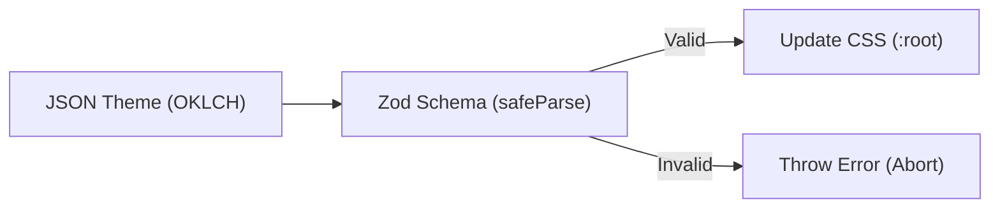

# Diagram Architecture & Accessible Schematics

Diagrams exist to clarify architecture, flows, and ownership where linear prose falls short. Every schematic in this design system obeys quiet chrome restraint, orthogonal routing geometry, semantic OKLCH surface tokens, and accessible SVG semantics.

---

## Purpose

Govern the selection, geometric layout, visual restraint, and accessibility validation of inline SVG schematics, UI architecture figures, and Mermaid diagrams across documentation and showcase surfaces.

---

## Prerequisites

- **Design Tokens**: CSS custom properties from `src/index.css` (`--background`, `--card`, `--foreground`, `--muted-foreground`, `--border`, `--primary`) and `Geist Sans` / `Geist Mono` typography.
- **Verification**: Real browser or DOM validation ensuring zero clipped text, zero stroke overlap, and `prefers-reduced-motion` static fallback parity.

---

## Instructions

Follow this sequence before drawing or updating any technical diagram:

1. **Use the Paragraph & Table Gate first**: If two sentences or a 3-column Markdown table communicate the relationship clearly, keep prose or the table and skip drawing a diagram.
2. **Set the pattern and visual grammar before placing nodes**: Read [references/semantic-patterns-and-types.md](references/semantic-patterns-and-types.md) and pass one primary semantic pattern paired with one matching layout grammar.
3. **Keep within the hard Complexity Budget**: Enforce `<= 9` nodes, `<= 12` connectors, `<= 2` focal accent elements, and `<= 2` annotation callouts on a strict `4px` coordinate grid. Split larger systems into an _Overview + Detail_ diagram pair.
4. **Add orthogonal connectors and accessible SVG roles**: Apply all six connector routing rules, declare `role="img"` paired with `aria-labelledby`, `<title>`, and `<desc>`, and wrap wide SVGs inside `overflow-x-auto`.
5. **Run the 4-Question Remove Test and browser check**: Execute geometry validation (checking error states, label clearance, and WCAG 2.2 contrast) at `1x` viewport scale before shipping.

---

## 🏛️ Philosophy of Deletion & The Complexity Budget

Target **4/10 visual density**: a diagram is finished not when every internal module is boxed, but when nothing further can be deleted without losing clarity.

### Hard Complexity Budget (Per Diagram)

| Metric                                  | Maximum Allowed | Overflow Action                                                    |
| :-------------------------------------- | :-------------: | :----------------------------------------------------------------- |
| **Nodes**                               |       `9`       | Split into an Overview (`<= 6` nodes) + focused Detail diagrams    |
| **Connectors / Arrows**                 |      `12`       | Merge peer calls or move attribute mappings into a companion table |
| **Focal Accent Elements (`--primary`)** |       `2`       | Demote secondary elements to `--card` + `--border` hairlines       |
| **Annotation Callouts**                 |       `2`       | Move secondary commentary into surrounding body prose              |

### The 4-Question Remove Test

1. Can any node be deleted without hurting comprehension?
2. Do two nodes always travel together and therefore belong merged into one?
3. Is any arrow obvious from spatial alignment alone?
4. Does colour, container position, or heading already explain any redundant badge?

---

## 📐 The 6 Mandatory Orthogonal Connector Rules

Every rendered schematic violates the craft floor if it breaks any of these routing constraints:

1. **Orthogonal Routing Only**: Connectors between off-axis boxes must use crisp right-angle elbows (`rx=8`, minimum `rx=6` in tight panels); reserve straight lines strictly for axis-aligned endpoints. Zero diagonal slants.
2. **Masked Label Gaps**: Edge labels (`<= 14` characters, uppercase `Geist Mono`) sit over an opaque surface mask (`fill="var(--background)"`) maintaining a visible `6px to 10px` breathing gap around the stroke.
3. **Zero Overlapping Paths**: Separate parallel lines by at least `12px`. If two routes must cross once orthogonally, render a subtle bridge arc rather than merging strokes.
4. **Fan Attach Points**: Distribute multiple connectors landing on one box edge evenly along its span (`L * k / (N + 1)`), keeping `>= 12px` spacing (`>= 8px` minimum on compact boxes).
5. **Zero Transit Behind Non-Endpoint Nodes**: Route lines cleanly around intervening boxes. Only if geometry permits zero alternate path, render a dashed `4,3` behind-stroke with no arrowhead terminating on the intermediate box.
6. **Strict Paint Order (Arrows Before Boxes)**: Draw `<g data-layer="connectors">` before `<g data-layer="nodes">` so paths connect flush under node fills without bleeding over borders.

---

## ♿ Accessible SVG, Typography & Mermaid Invariants

### Accessible SVG Contract

- Attach `role="img"` and `aria-labelledby="<slug>-title <slug>-desc"` on non-decorative `<svg>` elements (`aria-hidden="true"` on purely decorative icons).
- Place `<title id="<slug>-title">` (`<= 60` characters naming the subject) as the first child before `<defs>`, followed immediately by `<desc id="<slug>-desc">` stating one concrete sentence of architectural meaning.
- Wrap fixed-`viewBox` inline SVGs inside `<div className="overflow-x-auto">` with `min-w-[...]` matching the `viewBox` width so mobile screens scroll locally without horizontal page blowouts.
- If motion is enabled (`reveal` or pulse emphasis), guarantee the complete static diagram renders legibly with zero JavaScript and under `prefers-reduced-motion: reduce`.

### Typography & Contrast Discipline

- **Typography Split**: Node names use `Geist Sans` (`font-semibold`), titles align to clean display tracking, and ports, protocols, payloads, and connector tags use `Geist Mono` (`tabular-nums`). Never blanket-apply monospace to prose names.
- **Colour Tokens**: Ground diagrams with `--background` / `--card`, `1px` `--border` strokes (zero drop-shadow blobs), `--foreground` / `--muted-foreground` copy (`>= 4.5:1` contrast, `>= 3:1` connector strokes), and reserve `--primary` strictly for `1 or 2` focal nodes.

### Mermaid Grammar Guards in Markdown

When embedding Mermaid in Markdown documents:

- Restrict blocks strictly to supported types: `flowchart TD/LR`, `sequenceDiagram`, `stateDiagram-v2`, `classDiagram`, `erDiagram`, `xychart-beta`.
- Always quote node labels containing parentheses, colons, or brackets: `id["Validate (Zod)"]` rather than unquoted `id[Validate (Zod)]`.
- Exclude raw HTML tags (`<br/>`, `<b>`) from node strings and keep node count `<= 9`.

---

## Examples

### 1. Theme-Reactive Accessible Orthogonal Inline SVG

```tsx
export function TokenPipelineDiagram() {
  const stages = [
    { x: 20, w: 140, title: "Raw JSON Input", sub: "theme.json", focal: false },
    { x: 236, w: 144, title: "Zod Schema Gate", sub: "safeParse()", focal: true },
    { x: 456, w: 164, title: "CSS Token Root", sub: ":root / .dark", focal: false },
  ];

  return (
    <div className="w-full overflow-x-auto rounded-xl border border-border bg-card p-4">
      <svg
        role="img"
        aria-labelledby="pipeline-title pipeline-desc"
        viewBox="0 0 640 160"
        className="mx-auto block h-auto w-full max-w-[640px] min-w-[560px]"
      >
        <title id="pipeline-title">Token Validation and Theme Application Flow</title>
        <desc id="pipeline-desc">
          Validates incoming OKLCH JSON tokens with Zod, rejecting invalid payloads before mutating
          CSS properties.
        </desc>
        <g fill="none" stroke="var(--muted-foreground)" strokeWidth="1.5">
          <path d="M 160 64 H 236" />
          <path d="M 380 64 H 456" />
          <path d="M 308 92 V 124 H 348" strokeDasharray="4 4" />
        </g>
        {stages.map((s) => (
          <g key={s.title}>
            <rect
              x={s.x}
              y={36}
              width={s.w}
              height={56}
              rx={8}
              fill="var(--card)"
              stroke={s.focal ? "var(--primary)" : "var(--border)"}
              strokeWidth={s.focal ? 1.5 : 1}
            />
            <text
              x={s.x + s.w / 2}
              y={60}
              textAnchor="middle"
              fill="var(--foreground)"
              className="font-sans text-xs font-semibold"
            >
              {s.title}
            </text>
            <text
              x={s.x + s.w / 2}
              y={78}
              textAnchor="middle"
              fill="var(--muted-foreground)"
              className="font-mono text-[10px]"
            >
              {s.sub}
            </text>
          </g>
        ))}
        <rect
          x={348}
          y={106}
          width={172}
          height={36}
          rx={6}
          fill="var(--background)"
          stroke="var(--destructive)"
        />
        <text
          x={434}
          y={128}
          textAnchor="middle"
          fill="var(--destructive)"
          className="font-mono text-[10px]"
        >
          Error: Reject invalid token
        </text>
      </svg>
    </div>
  );
}
```

### 2. Quoted Mermaid Flowchart



---

## Limitations

- **Editorial schematics, not full data suites**: Orthogonal node diagrams cap strictly at `9` nodes; multi-hundred-row time series, financial charts, or dense trace plots belong in `src/components/ui/chart.tsx` or structured data tables.
- **Font availability offline**: When diagrams render outside the app bundle without local `@fontsource/geist-sans` / `@fontsource/geist-mono`, declare clean system fallbacks (`system-ui`, `ui-monospace`).

---

## Troubleshooting

| Symptom                                              | Cause                                                                             | Solution                                                                                                        |
| :--------------------------------------------------- | :-------------------------------------------------------------------------------- | :-------------------------------------------------------------------------------------------------------------- |
| Arrow strokes cut visibly through node label text    | Label `<text>` rendered directly on stroke without opaque background rect masking | Add an opaque `<rect fill="var(--background)" rx="2">` behind `<text>` maintaining a `6px` to `10px` stroke gap |
| Mobile viewport forces full-page horizontal scroll   | Fixed pixel `<svg width="...">` lacks responsive overflow containment             | Set `viewBox`, assign `min-w-[...]` cleanly, and wrap `<svg>` inside `<div className="overflow-x-auto">`        |
| Mermaid parse error fails to render diagram          | Unquoted node string contains `()`, `[]`, or inline HTML tags                     | Quote label text explicitly (`id["Label (Detail)"]`) and remove raw HTML tags inside Mermaid blocks             |
| Schematic reads as cluttered wall of identical boxes | Over `9` nodes placed in one figure, or accent colour applied to too many nodes   | Merge tight node pairs, strip redundant arrows via the Remove Test, and keep accent strokes to `<= 2` nodes     |
